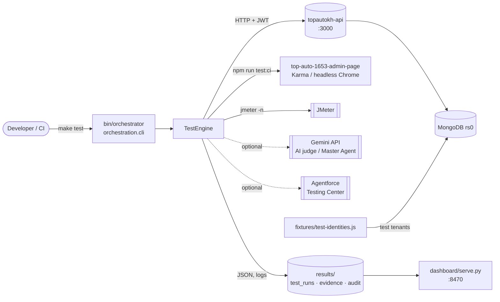
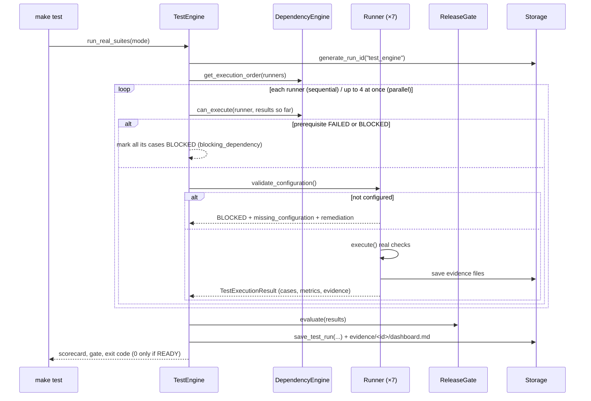
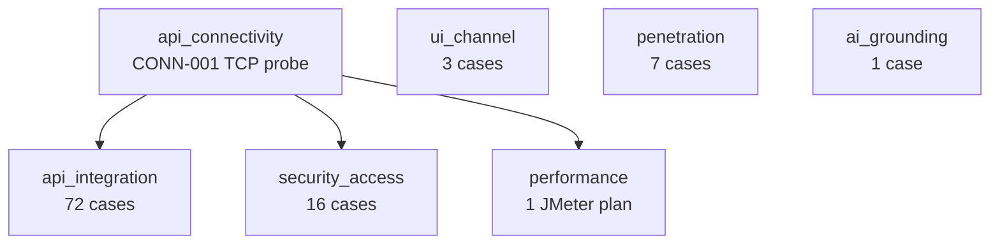

# Architecture

How the engine is built and how a run flows through it. For usage, see [USER_GUIDE.md](USER_GUIDE.md). For extending it, see [DEVELOPMENT.md](DEVELOPMENT.md).

## 1. Purpose and boundaries

`automation-testing` is a **black-box, pre-release test engine** for the TopAuto (Auto360) stack. It runs real checks against a stack someone else started (backend, MongoDB, admin build), records evidence for every test case, and gives one release verdict.

It does **not**:
- start, stop or deploy anything (servers, MongoDB, the admin UI);
- change the code of the repos it tests;
- need cloud services (Gemini and Agentforce are optional add-ons).

## 2. System context



The engine reads two things from the backend repo on disk: `JWT_SECRET` from its `.env` (when it isn't set in this repo's settings), and a few source files that the legacy static checks grep. Everything else goes over the network.

## 3. Components

| Layer | Module | Responsibility |
|---|---|---|
| Entry | `orchestration/cli.py`, `__main__.py`, `run.py`, `bin/orchestrator` | Commands `test`, `preflight`, `status`, `catalog`, `audit`, `run` |
| Config | `orchestration/config.py`, `config.json` | Layered settings; resolves `ENGINE_ROOT`, `WORKSPACE_ROOT`, `RESULTS_DIR`, sibling repo paths ([CONFIGURATION.md](CONFIGURATION.md)) |
| Engine | `test_engine/engine.py` | Registers the runners, orders them, runs them sequentially or in parallel, evaluates the gate, saves the run |
| Runner contract | `test_engine/contract.py` | `BaseTestRunner` (`discover_test_cases`, `validate_configuration`, `execute`), `TestCaseResult`, `TestExecutionResult`, `TestStatus` |
| Runners | `test_engine/runners/*.py` | One per suite: `connectivity`, `api`, `ui`, `performance`, `security`, `penetration`, `ai_grounding` |
| Security provider | `test_engine/security/provider.py` | The 16 security checks (local HTTP provider; Salesforce/custom-command providers are optional) |
| Dependencies | `test_engine/dependency_engine.py` | Prerequisite DAG and topological order |
| Gate | `test_engine/release_gate.py` | READY FOR ROLLOUT / NOT READY / VALIDATION INCOMPLETE |
| Storage | `test_engine/storage.py` | Run IDs, `test_runs/<id>.json`, `evidence/<id>/…` |
| Reporting | `test_engine/reporting.py` | Console scorecard, Markdown dashboard, history lines |
| Catalog | `test_engine/catalog/*.py` | 63 features, 101 test cases, coverage and traceability (feature ↔ test) |
| Preflight | `test_engine/preflight.py` | 12 environment checks (7 required) with remediation hints |
| Dashboard | `dashboard/serve.py`, `index.html` | Read-only local web UI over `RESULTS_DIR` |
| Master Agent (optional) | `orchestrator.py`, `master_agent/`, `escalation/`, `review/`, `models/` | Gemini-driven task loop with a Pro reviewer ([ORCHESTRATION_GUIDE.md](ORCHESTRATION_GUIDE.md)) |
| Guardrails | `security/command_policy.py`, `security/sanitizer.py`, `tools/workspace_tools.py` | Command allow/confirm/deny policy, secret redaction, workspace-bounded file and command tools |
| Audit | `audit/logger.py` | JSONL + Markdown trail of orchestration decisions |
| Legacy | `test_engine/pillars/*.py` | Old static grep checks (`test --static`); never affect the gate |

## 4. A run, step by step



### Suites and the dependency graph



If `api_connectivity` fails, the three suites under it are **BLOCKED**, not failed. A down backend is an environment problem, not an application defect. UI, penetration and AI grounding have no prerequisites.

| Suite (runner) | Pillar | Gate | What runs |
|---|---|---|---|
| `api_connectivity` | API & Integration | (via deps) | TCP socket probe to `API_BASE_URL` |
| `api_integration` | API & Integration | **required** | 72 HTTP cases from `STANDARD_API_CASES` with JWTs minted from `JWT_SECRET`; some add business checks |
| `security_access` | Security & Access | **required** | Missing/malformed tokens, authz/RBAC, NoSQL injection, SSRF, security headers |
| `penetration` | Penetration Check | **required** | 7 adversarial prompts against a guardrail baseline; Gemini judge if a key is set |
| `ui_channel` | UI & Channel | optional | `UI_TEST_COMMAND` (default: admin `npm run test:ci`), else Playwright / UTAM / Provar |
| `performance` | Performance | optional | `jmeter -n` with `performance/smoke_test.jmx`, latency/throughput metrics |
| `ai_grounding` | AI Grounding | optional | Agentforce Testing Center batch (BLOCKED unless configured) |

### Status model

Test cases and suites use five statuses (`TestStatus`):

| Status | Meaning |
|---|---|
| PASSED | ran, and the assertion held; evidence recorded |
| FAILED | ran, and the assertion did not hold (application defect, or a wrong expectation) |
| BLOCKED | could not run: missing tool/config/fixture or a failed prerequisite. Always carries `blocking_dependency`, `missing_configuration` and `required_remediation` |
| SKIPPED | deliberately not run |
| PENDING | discovered but not executed yet |

A BLOCKED case is never counted as executed. The pass rate is `passed / executed`.

### Release gate

`ReleaseGateEvaluator` looks only at the **required** suites (`api_integration`, `security_access`, `penetration`):

1. Any required suite FAILED or BLOCKED → **NOT READY**.
2. Else, any required suite missing, PENDING, or PASSED without evidence → **VALIDATION INCOMPLETE**.
3. Else (all required suites PASSED with evidence) → **READY FOR ROLLOUT**.

Failures in optional suites become `informational_warnings`. The CLI exits `0` only for READY FOR ROLLOUT, so CI can use the exit code.

## 5. Identities and authentication

The API and security suites don't log in through the UI. They mint HS256 JWTs with the backend's `JWT_SECRET`, in the shapes the backend's auth middleware expects:

| Identity | JWT `type` | IDs from | Used for |
|---|---|---|---|
| BASIC tenant admin | `final` | `TEST_BASIC_COMPANY_ID`, `TEST_BASIC_EMPLOYEE_ID` | most API cases |
| STANDARD tenant admin | `final` | `TEST_PREMIUM_COMPANY_ID`, `TEST_PREMIUM_EMPLOYEE_ID` (or real login with `TEST_PREMIUM_PHONE/PASSWORD`) | cases with `requires_feature` (payroll, HR) |
| Platform admin | `admin-auth` | `TEST_PLATFORM_COMPANY_ID`, `TEST_PLATFORM_ADMIN_ID` | cases with `requires_platform_admin` |

`fixtures/test-identities.js` creates those records in a local database. A missing identity makes its cases BLOCKED with `FIXTURE_MISSING_PREMIUM_TENANT` or `FIXTURE_MISSING_PLATFORM_ADMIN`; they are never silently skipped.

## 6. Configuration resolution

```
orchestration/config.json   <   <repo>/.env   <   exported shell variables   <   code overrides (tests)
```

| Root | Default | Holds |
|---|---|---|
| `ENGINE_ROOT` | this repo | the package, `performance/`, `ui_tests/`, fixtures |
| `WORKSPACE_ROOT` | parent of this repo | sibling repos (`topautokh-api`, `top-auto-1653-admin-page`) |
| `RESULTS_DIR` | `<repo>/results` | `test_runs/`, `evidence/`, `audit/` |

Engine-owned files always resolve from the package, never from `WORKSPACE_ROOT`. That's why the repo works wherever it is cloned. Details: [CONFIGURATION.md](CONFIGURATION.md).

## 7. Storage layout

```
results/
├── test_runs/<run_id>.json     run document: mode, timings, gate, every TestCaseResult, runner results
├── evidence/<run_id>/          one file per evidence item (paths in the run doc are relative to RESULTS_DIR)
│   ├── connectivity_probe.json, api_response.json, api_test_results.json
│   ├── security_audit.json, penetration_evaluation_report.json
│   ├── ui_execution.log, jmeter_results.jtl, jmeter_console.log
│   └── dashboard.md            Markdown scorecard for the run
└── audit/
    ├── command_execution_audit.jsonl   every command the agent tools ran or refused
    └── orchestration_audit.{jsonl,md}  Master Agent decisions
```

Run IDs look like `test_engine_YYYYMMDD_HHMMSS_<6 hex>`. Nothing is deleted automatically; see [OPERATIONS.md](OPERATIONS.md#retention).

## 8. Optional Master Agent layer

`bin/orchestrator run --task "…"` sends a task through a Gemini "Flash" master agent that plans, uses workspace tools (read files, run allowed commands), runs the test engine, and escalates to a "Pro" reviewer on architecture, security, critical or persistent failures (`escalation/policy.py`, at most `REVIEW_MAX_ITERATIONS` rounds). Without `GEMINI_API_KEY` it runs a deterministic fallback: it reads the changed files and runs the tests, without any model planning, and the trace says so. **The test engine never needs this layer.** Full description: [ORCHESTRATION_GUIDE.md](ORCHESTRATION_GUIDE.md).

## 9. Design decisions

| Decision | Why |
|---|---|
| Python standard library only | Nothing to install for the core; runs on any machine with Python 3.9 |
| BLOCKED is separate from FAILED | A missing backend or fixture must never read as a product defect, and never as a pass |
| Gate uses required suites only | UI/perf/AI tooling is often missing on dev machines; the core API, security and pen checks decide rollout |
| Evidence required for PASS | A suite that passes without evidence counts as not validated (VALIDATION INCOMPLETE) |
| Minted JWTs instead of UI login | Deterministic, fast, and independent of rate-limited login endpoints |
| Results outside git | Run documents and evidence contain API responses with tenant data; they stay local |
| Never start services | The people running the stack own its lifecycle and logs |

## 10. Known limitations

See [DEPLOYMENT_READINESS.md](DEPLOYMENT_READINESS.md#known-limitations) for the current list (hard-coded record IDs in some API cases, API cases that write data, stale JSON catalog snapshots, and more).
