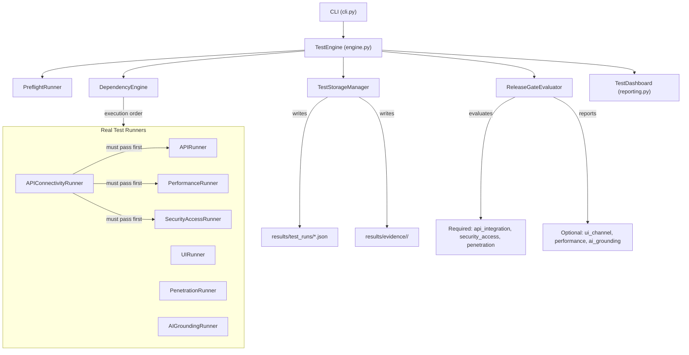

# AutoPilot — 6-Pillar Pre-Production Validation Engine

> **Historical document** (written inside the TopAuto workspace, Sept–Oct 2026). The current docs are in [docs/](../README.md) and win where they disagree. Paths were updated for this repo; counts and examples are from that period.

AutoPilot is the orchestration layer that validates the Top Auto 1653 application before every release. It coordinates real test runners across six quality pillars, enforces a dependency DAG between suites, persists evidence to disk, evaluates a release gate, and generates human-readable dashboards — all locally, with no cloud dependency.

## What it does

- Runs **101 application-level test cases** across six pillars (API, UI, Security, Penetration, Performance, AI Grounding).
- Evaluates an **authoritative release gate** that blocks rollout when required suites fail.
- Stores every run as a JSON document with per-test-case evidence files, giving a full audit trail.
- Provides a **CLI** (`python3 -m orchestration` or `python3 run.py`) for running tests, inspecting history, and checking prerequisites.
- Optionally integrates a **Master Agent / Specialist Reviewer** loop (Gemini-powered) for AI-assisted orchestration.

## What it does NOT do

- It does not replace unit tests. The project has 144 internal unit tests (`orchestration/tests/`) that verify the engine itself.
- It does not start, stop, or modify the backend, database, or frontend. Those are prerequisites you manage separately.
- Static code grep-based checks exist but are **deprecated and excluded from the release gate**.

## Supported environments

| Environment | Status | Notes |
|---|---|---|
| **macOS (local dev)** | Verified | Primary development platform. All commands tested on Darwin/ARM64. |
| **Linux (server)** | Server-testable | Dashboard + batch test execution work. See [Server Deployment Guide](#server-deployment-guide). |
| **Windows** | Untested | Not verified. Path handling uses `pathlib` so it may work, but no guarantees. |

## Known limitations

- **No external Python dependencies.** The engine is 100% stdlib Python 3.8+.
- **Evidence accumulates indefinitely** (~155 MB across 696 runs currently). Manual cleanup or a retention policy is needed for long-running servers.
- **Dashboard is HTTP-only, localhost-only.** Server exposure requires a reverse proxy with TLS.
- **Optional AI features** (Master Agent, AI Grounding) require external APIs (Gemini, Agentforce) that are not included.

---

## Architecture



### Six pillars and their runner mappings

| Pillar | Runner(s) | What it tests |
|---|---|---|
| **API & Integration** | `api_connectivity` → `api_integration` | TCP socket probe, then 72 endpoint tests (CRUD, auth, payments, HR, payroll) |
| **UI & Channel** | `ui_channel` | Angular admin headless tests via Karma/Jasmine (40 specs) or Playwright |
| **Performance** | `performance` | JMeter smoke test against the API |
| **Security & Access** | `security_access` | Auth bypass, RBAC enforcement, JWT validation, rate limiting |
| **Penetration Check** | `penetration` | NoSQL injection, XSS, header injection, CORS |
| **AI Grounding** | `ai_grounding` | AI response grounding validation (requires Agentforce or Testing Center) |

### Dependency DAG

```
api_connectivity (must pass)
  ├── api_integration
  ├── performance
  └── security_access

ui_channel        (independent)
penetration       (independent)
ai_grounding      (independent)
```

If `api_connectivity` fails (backend not running), the three dependent suites become **BLOCKED** — they do not execute.

### Execution lifecycle

1. **Preflight** — verify Python, Node.js, backend, MongoDB, write access.
2. **Dependency resolution** — topological sort of runners.
3. **Sequential or parallel execution** — each runner validates its configuration, then executes.
4. **Evidence capture** — each runner writes JSON/log artifacts to `results/evidence/<run_id>/`.
5. **Summary calculation** — counts by status (PASSED/FAILED/BLOCKED/SKIPPED/PENDING).
6. **Release gate evaluation** — required suites must all PASS; optional suites report warnings.
7. **Persistence** — full run document saved to `results/test_runs/<run_id>.json`.
8. **Dashboard generation** — Markdown and CLI summaries produced.

---

## Prerequisites

**Only Python 3.8+** is required to use the dashboard, catalog, preflight, and unit tests. No backend, database, or additional services needed.

Running the actual application test suite (the `test` command) additionally requires:
- Node.js 18+
- The `topautokh-api` backend running on `localhost:3000`
- MongoDB running locally (`localhost:27017`, `replicaSet=rs0`)
- Environment variables: `MONGO_URI`, `JWT_SECRET` (in `topautokh-api/.env`)

The preflight command tells you exactly what is missing and how to fix it.

---

## Quick start

> **Running commands:** Run from the repo root, or from anywhere with `bin/orchestrator`.
>
> ```bash
> # From the repo root:
> python3 -m orchestration <command>
> bin/orchestrator <command>   # works from any directory
>
> # From inside orchestration/:
> python3 run.py <command>
> ```
>
> Note: `python3 -m orchestration` does not work from inside `orchestration/` — that is a Python limitation (`-m` cannot find a package when CWD is the package itself). Use `run.py` instead.

### Standalone commands (no backend or database needed)

These work immediately with just Python installed. They read static catalogs and previously persisted test-run evidence.

#### Launch the dashboard

```bash
python3 orchestration/dashboard/serve.py       # from the repo root (or: make dashboard)
# or
cd orchestration && python3 dashboard/serve.py  # from inside orchestration/
```

Open `http://localhost:8470` in a browser. The dashboard reads persisted results from `results/test_runs/` and `results/evidence/` (or `RESULTS_DIR`). Press `Ctrl+C` to stop. No backend, no database, no services required.

#### Inspect the test catalog and coverage

```bash
python3 -m orchestration catalog                  # coverage summary
python3 -m orchestration catalog --features       # feature inventory
python3 -m orchestration catalog --tests           # test case inventory
python3 -m orchestration catalog --traceability    # feature ↔ test matrix
python3 -m orchestration catalog --json            # JSON output
python3 -m orchestration catalog --module "Finance" # filter by module
python3 -m orchestration catalog --tests --priority P0  # filter by priority
```

#### View recent test runs (from persisted history)

```bash
python3 -m orchestration test --runs
```

#### Check prerequisites

```bash
python3 -m orchestration preflight
```

Outputs a structured report of required and optional checks. Fix any REQUIRED failures before running the test suite.

#### View orchestration system status

```bash
python3 -m orchestration status
```

#### View audit trail

```bash
python3 -m orchestration audit --limit 5
```

#### Run orchestration unit tests (engine self-tests)

```bash
python3 orchestration/tests/run_all_tests.py
```

144 unit tests verify the engine framework. Most pass without services; a few modules that test live runners will timeout without the backend running (this is expected, not a failure).

### Full-stack commands (require backend + database)

These commands execute real tests against the running application. Make sure the preflight passes first.

#### Start the backend (in a separate terminal)

```bash
cd topautokh-api && npm run dev
```

#### Run the full test suite

```bash
python3 -m orchestration test
```

Runs all six pillars sequentially, evaluates the release gate, and prints the result. Exit code `0` = READY FOR ROLLOUT, `1` = otherwise.

#### Run a single pillar

```bash
python3 -m orchestration test --pillar api
python3 -m orchestration test --pillar security
python3 -m orchestration test --pillar pen
python3 -m orchestration test --pillar ui
python3 -m orchestration test --pillar perf
python3 -m orchestration test --pillar grounding
```

#### Run in parallel mode

```bash
python3 -m orchestration test --mode parallel
```

### Diagnose a blocked suite

If a suite shows BLOCKED:

1. Check which prerequisite failed: the blocked reason names it (usually `api_connectivity`).
2. Run preflight: `python3 -m orchestration preflight`
3. Common cause: the backend is not running. Start it in another terminal:
   ```bash
   cd topautokh-api && npm run dev
   ```
4. For AI Grounding (`AIG-001`): this suite requires an external Agentforce/Testing Center API. It is **optional** and does not block rollout.

---

## Configuration reference

Configuration is loaded in priority order: defaults → `orchestration/config.json` → `.env` → environment variables → code overrides.

### Core settings

| Variable | Default | Description |
|---|---|---|
| `PRIMARY_MODEL` | `gemini-3.8-flash` | AI model for the Master Agent loop |
| `PRIMARY_THINKING_LEVEL` | `high` | Thinking level: `low`, `medium`, `high` |
| `REVIEW_MODEL` | `gemini-3.1-pro-preview` | AI model for the Specialist Reviewer |
| `REVIEW_THINKING_LEVEL` | `high` | Reviewer thinking level |
| `REVIEW_ENABLED` | `true` | Enable the review loop |
| `REVIEW_MAX_ITERATIONS` | `3` | Maximum review iterations |
| `TEST_ENGINE_ENABLED` | `true` | Enable test execution during orchestration |

### Backend and database

| Variable | Default | Description |
|---|---|---|
| `API_BASE_URL` | `http://localhost:3000` | Backend base URL |
| `API_HEALTH_ENDPOINT` | `/health` | Health check path |
| `BACKEND_WORKSPACE` | `topautokh-api` | Path to backend repo (relative or absolute) |
| `MONGO_URI` | *(from .env)* | MongoDB connection string. **Required.** Never set in config.json. |
| `JWT_SECRET` | *(from .env)* | JWT signing secret for test token generation. **Required.** Never set in config.json. |

### External runner integrations

| Variable | Default | Description |
|---|---|---|
| `UI_TEST_COMMAND` | `npm --prefix top-auto-1653-admin-page run test:ci` | Command to run UI tests |
| `ENABLE_ANGULAR_HEADLESS_TEST` | `true` | Use Angular headless (Karma) instead of Playwright |
| `JMETER_PATH` | `/opt/homebrew/bin/jmeter` | Path to JMeter binary |
| `JMETER_TEST_PLAN` | `orchestration/performance/smoke_test.jmx` | JMeter test plan file |
| `SECURITY_PROVIDER` | `local` | Security test provider (`local`, `salesforce`) |
| `SECURITY_BASE_URL` | *(falls back to API_BASE_URL)* | Base URL for security tests |

### AI integration (optional)

| Variable | Default | Description |
|---|---|---|
| `GEMINI_API_KEY` / `GOOGLE_API_KEY` | *(not set)* | Gemini API key for Master Agent. Optional. |
| `TESTING_CENTER_API_URL` | *(not set)* | Agentforce Testing Center URL for AI grounding |
| `AGENTFORCE_REGRESSION_BATCH_ID` | *(not set)* | Agentforce regression batch ID |
| `AGENTFORCE_API_TOKEN` | *(not set)* | Agentforce API token. **Never commit.** |

### Storage

| Variable | Default | Description |
|---|---|---|
| `RESULTS_DIR` | `results/` (in this repo) | Test runs, evidence and audit logs |
| `WORKSPACE_ROOT` | parent of this repo | Folder that holds the sibling TopAuto repos |
| `BACKEND_WORKSPACE` | `$WORKSPACE_ROOT/topautokh-api` | Backend repo (preflight, JWT secret fallback, static pillars) |
| `ADMIN_WORKSPACE` | `$WORKSPACE_ROOT/top-auto-1653-admin-page` | Angular admin repo (UI pillar) |

### Test fixture environment variables

These are set in `.env` or exported before running tests. **Never commit actual values.**

```bash
# Example .env (use your own values)
MONGO_URI=mongodb://localhost:27017/topauto1653_ecommerce?replicaSet=rs0
JWT_SECRET=your-secret-here
TEST_PHONE=000000000
TEST_PASSWORD=Admin@1234
```

---

## Test result statuses

| Status | Meaning |
|---|---|
| **PASSED** | The test executed and all assertions succeeded. |
| **FAILED** | The test executed but one or more assertions did not match expected behavior. |
| **BLOCKED** | The test could not execute because a prerequisite failed or a required tool is missing. BLOCKED is **not** a pass and **not** counted as executed. |
| **SKIPPED** | The test was intentionally excluded from this run (e.g., filtered by pillar). |
| **NOT RUN / PENDING** | The test exists in the catalog but was not selected or has not yet executed. |

### Pass rate calculation

- **Pass rate (of executed)** = PASSED / (PASSED + FAILED) × 100
- **Execution rate** = (PASSED + FAILED) / total selected × 100
- BLOCKED and SKIPPED tests are **excluded** from the pass-rate denominator.

### Release gate policy

The release gate evaluates **required suites** only:

| Suite | Required? |
|---|---|
| `api_integration` | **Yes** |
| `security_access` | **Yes** |
| `penetration` | **Yes** |
| `api_connectivity` | No (implicit via dependency) |
| `ui_channel` | No (optional) |
| `performance` | No (optional) |
| `ai_grounding` | No (optional) |

- **READY FOR ROLLOUT**: all three required suites PASSED with evidence.
- **NOT READY**: any required suite FAILED or BLOCKED.
- **VALIDATION INCOMPLETE**: a required suite is PENDING or was not executed.

Optional suites that fail or are blocked appear as **informational warnings** and do not prevent rollout.

---

## Troubleshooting

### Backend unavailable

**Symptom:** `api_connectivity` fails, and `api_integration`, `performance`, `security_access` are all BLOCKED.

**Fix:** Start the backend in a separate terminal:
```bash
cd topautokh-api && npm run dev
```
Then re-run tests.

### Database or identity mismatch

**Symptom:** API tests return "No user found" or 401 errors unexpectedly.

**Fix:** Ensure test identity fixtures are provisioned in the local database. `fixtures/test-identities.js` creates deterministic `aaa…` test records. Re-run it if the database was reset:
```bash
make fixtures         # dry run: what exists
make fixtures-apply   # create missing records (local DB only)
```

### Missing test fixture environment variables

**Symptom:** Tests fail with "invalid token" or authentication errors.

**Fix:** Ensure `JWT_SECRET`, `TEST_PHONE`, and `TEST_PASSWORD` are set in `topautokh-api/.env` or exported.

### Rate-limit interference

**Symptom:** Security tests return 429 instead of expected 401/400 responses.

**Fix:** The backend uses `express-rate-limit` v8.7.0 with a 15-minute fixed window and in-memory store. Wait 15 minutes for the window to reset, or restart the backend to clear the in-memory store. The test engine includes a pre-flight rate-limit clearance check.

**Budget:** 2 failed auth requests per run, 7 consecutive runs within a 15-minute window.

### Browser test dependencies

**Symptom:** UI tests fail with missing browser or Playwright errors.

**Fix:** The default path uses Angular headless (Karma/Jasmine) via the `UI_TEST_COMMAND` config. If using Playwright directly:
```bash
cd orchestration/ui_tests && npm install && npx playwright install chromium
```

### Missing optional AI provider

**Symptom:** AI Grounding suite shows BLOCKED with `AIG-001`.

**This is expected.** The AI grounding pillar requires an Agentforce Testing Center or equivalent. Without it, the suite is BLOCKED but the release gate treats it as optional — it does not prevent READY FOR ROLLOUT.

### Long-running tests

**Symptom:** The test run appears to hang.

**Explanation:** A full sequential run takes 10–15 minutes. The API integration suite alone (72 test cases) typically takes 5–10 minutes. Use `--mode parallel` for faster execution, or `--pillar <name>` to run a specific suite.

### Missing or malformed evidence

**Symptom:** Dashboard shows incomplete data or the run file cannot be parsed.

**Fix:** Check the evidence directory exists:
```bash
ls results/evidence/<run_id>/
ls results/test_runs/<run_id>.json
```
If files are corrupt, re-run the suite. The engine generates new evidence on each run.

---

## Project structure

```
orchestration/
├── cli.py                          # CLI entry point
├── config.py                       # Configuration loading and layering
├── config.json                     # Default configuration values
├── orchestrator.py                 # Master Agent orchestration loop
├── core_types.py                   # Core enums and dataclasses
├── run.py                          # Convenience entry point (works from any directory)
├── __init__.py
├── __main__.py                     # Enables `python3 -m orchestration`
│
├── test_engine/
│   ├── engine.py                   # TestEngine coordinator
│   ├── contract.py                 # TestStatus, TestCaseResult, TestExecutionResult, BaseTestRunner
│   ├── dependency_engine.py        # Dependency DAG and topological sort
│   ├── release_gate.py             # ReleaseGateEvaluator (required/optional policy)
│   ├── reporting.py                # TestDashboard, TestRunSummary, markdown/CLI output
│   ├── storage.py                  # TestStorageManager (JSON persistence)
│   ├── preflight.py                # PreflightRunner (environment checks)
│   ├── failure_escalation.py       # TestFailureEscalator
│   │
│   ├── runners/
│   │   ├── connectivity_runner.py  # TCP socket probe (api_connectivity)
│   │   ├── api_runner.py           # HTTP endpoint tests (api_integration)
│   │   ├── ui_runner.py            # Angular/Playwright tests (ui_channel)
│   │   ├── performance_runner.py   # JMeter integration (performance)
│   │   ├── security_runner.py      # Auth/RBAC/JWT tests (security_access)
│   │   ├── penetration_runner.py   # Injection/XSS tests (penetration)
│   │   └── ai_grounding_runner.py  # Agentforce integration (ai_grounding)
│   │
│   ├── pillars/                    # [DEPRECATED] Legacy static grep-based checks
│   │   └── *.py
│   │
│   ├── catalog/
│   │   ├── test_catalog.json       # 95 cataloged test case definitions
│   │   ├── test_catalog.py         # Test catalog loader
│   │   ├── functionality_catalog.json  # 57 application features
│   │   ├── functionality_catalog.py    # Feature catalog loader
│   │   └── coverage.py             # Coverage calculator
│   │
│   └── security/
│       └── provider.py             # Security test provider abstraction
│
├── tests/
│   ├── run_all_tests.py            # Test runner (144 unit tests)
│   ├── test_release_gate_authoritative.py  # Release gate policy tests
│   ├── test_reporting_and_dashboard.py     # Reporting/dashboard tests
│   ├── test_test_engine.py         # Engine integration tests
│   ├── test_catalog_and_coverage.py        # Catalog/coverage tests
│   └── ... (22 test modules total)
│
├── dashboard/                      # Local web dashboard
│   ├── serve.py                    # Python HTTP server (localhost:8470)
│   └── index.html                  # Dashboard UI
│
├── models/                         # AI model clients
│   ├── gemini_client.py
│   ├── ollama_client.py
│   ├── mock_client.py
│   └── router.py
│
├── review/                         # Specialist reviewer loop
│   ├── loop.py
│   ├── contract.py
│   └── normalizer.py
│
├── audit/                          # Audit logging
│   └── logger.py
│
├── security/                       # Security policy and sanitization
│   ├── command_policy.py
│   └── sanitizer.py
│
├── escalation/                     # Failure escalation policy
│   └── policy.py
│
├── master_agent/                   # Master agent execution loop
│   └── execution_loop.py
│
├── performance/                    # JMeter test plans
│   └── smoke_test.jmx
│
└── ui_tests/                       # Playwright test specs
    ├── playwright.config.ts
    ├── auth.spec.ts
    ├── cashflow.spec.ts
    ├── car-sales.spec.ts
    ├── dashboard.spec.ts
    └── fixtures/
        └── auth.fixture.ts

results/            # RESULTS_DIR (gitignored)
├── test_runs/                      # Persisted test run JSON documents
│   └── <run_id>.json
├── evidence/                       # Per-run evidence directories
│   └── <run_id>/
│       ├── connectivity_probe.json
│       ├── api_test_results.json
│       ├── security_*.json
│       ├── penetration_*.json
│       └── dashboard.md
└── audit/                          # Orchestration audit trail
    ├── orchestration_audit.jsonl
    └── orchestration_audit.md
```

---

## Server Deployment Guide

This section covers installing and running AutoPilot on a dedicated Linux server. The simplest supported architecture runs all components on a single host.

### Cloud-readiness verdict

**SERVER-TESTABLE** — the application installs and runs on a Linux server for dashboard viewing and batch test execution. It is not production-ready. See [Production Requirements](#unimplemented-production-requirements) for what remains.

### Deployment architecture

```
┌──────────────────────────────────────────────────────┐
│  Server Host                                         │
│                                                      │
│  ┌─────────────────┐   ┌────────────────────────┐   │
│  │  Reverse Proxy   │──▶│  AutoPilot Dashboard   │   │
│  │  (nginx/caddy)   │   │  127.0.0.1:8470        │   │
│  │  :443 TLS        │   └────────┬───────────────┘   │
│  └─────────────────┘            │                    │
│                                  ▼                    │
│  ┌────────────────────────────────────────────────┐  │
│  │  AutoPilot CLI (python3 -m orchestration)      │  │
│  │  - Preflight / Test / Catalog / Audit          │  │
│  └────────────┬──────────────────┬────────────────┘  │
│               │                  │                    │
│  ┌────────────▼──┐    ┌─────────▼─────────┐         │
│  │  topautokh-api │    │  MongoDB           │         │
│  │  :3000         │    │  :27017            │         │
│  └───────────────┘    └───────────────────┘         │
│                                                      │
│  ┌────────────────────────────────────────────────┐  │
│  │  automation-testing/results/                   │  │
│  │    test_runs/ (JSON)   evidence/ (artifacts)   │  │
│  │    audit/ (JSONL + MD)                         │  │
│  └────────────────────────────────────────────────┘  │
└──────────────────────────────────────────────────────┘
```

**Co-located services:** The backend (topautokh-api) and MongoDB must be reachable from the orchestration process. They can run on the same host or be remote — configure `API_BASE_URL` and `MONGO_URI` accordingly.

**The dashboard is optional.** If you only need batch test execution (CLI), the dashboard server does not need to run.

### Server preparation (Ubuntu/Debian)

These commands are verified for Ubuntu 22.04+ / Debian 12+.

```bash
# 1. System packages
sudo apt update && sudo apt install -y python3 python3-venv git curl

# 2. Verify Python version (3.8+ required, 3.10+ recommended)
python3 --version

# 3. Install Node.js 18+ (required for backend and UI tests)
curl -fsSL https://deb.nodesource.com/setup_18.x | sudo -E bash -
sudo apt install -y nodejs
node --version

# 4. Create a dedicated application user
sudo useradd -r -m -s /bin/bash autopilot
sudo mkdir -p /opt/autopilot
sudo chown autopilot:autopilot /opt/autopilot

# 5. Clone the repos side by side (as autopilot user)
sudo -u autopilot bash -c 'mkdir -p /opt/autopilot/workspace && cd /opt/autopilot/workspace && git clone https://github.com/vonseyha/automation-testing.git && git clone <topautokh-api-url> topautokh-api'

# 6. Create data directories
sudo -u autopilot mkdir -p /opt/autopilot/workspace/automation-testing/results/{test_runs,evidence,audit}

# 7. Install backend dependencies
sudo -u autopilot bash -c 'cd /opt/autopilot/workspace/topautokh-api && npm install --production'

# 8. Verify the orchestration loads
sudo -u autopilot bash -c 'cd /opt/autopilot/workspace/automation-testing && python3 -m orchestration status'
```

### Configuration and secrets

**Never commit secrets to source control.** On a server, configure secrets via:

1. **Environment variables** (preferred):
   ```bash
   # /opt/autopilot/.env (readable only by autopilot user)
   export MONGO_URI="mongodb://localhost:27017/topauto1653_ecommerce?replicaSet=rs0"
   export JWT_SECRET="<generated-secret>"
   export WORKSPACE_ROOT="/opt/autopilot/workspace"
   ```
   ```bash
   sudo chmod 600 /opt/autopilot/.env
   sudo chown autopilot:autopilot /opt/autopilot/.env
   ```

2. **Backend `.env` file** (for the topautokh-api process):
   ```bash
   # /opt/autopilot/workspace/topautokh-api/.env
   # Same MONGO_URI and JWT_SECRET, readable only by autopilot user
   ```

3. **Secret rotation:** To rotate JWT_SECRET:
   - Generate a new secret: `openssl rand -hex 32`
   - Update both the backend `.env` and the orchestration environment
   - Restart the backend process
   - Existing JWTs become invalid (expected)

**Never set secrets in `config.json`** — that file is checked into version control.

### Network and access security

| Port | Service | Interface | Access |
|---|---|---|---|
| 3000 | topautokh-api | 127.0.0.1 | Internal only |
| 8470 | AutoPilot Dashboard | 127.0.0.1 | Internal only; expose via reverse proxy |
| 27017 | MongoDB | 127.0.0.1 | Internal only; never expose publicly |
| 443 | Reverse proxy (TLS) | 0.0.0.0 | Public (if dashboard access needed remotely) |

**Firewall rules (ufw example):**
```bash
sudo ufw default deny incoming
sudo ufw allow ssh
sudo ufw allow 443/tcp    # Only if exposing dashboard externally
sudo ufw enable
```

**The dashboard has no built-in authentication.** Before exposing it beyond localhost:
- Use a reverse proxy (nginx, Caddy) with TLS termination
- Add HTTP Basic Auth or integrate with an identity provider
- Restrict by IP or VPN

**CORS:** The dashboard serves from localhost and does not set CORS headers. If accessed through a reverse proxy, configure the proxy to add appropriate headers.

### Persistent storage and recovery

**Data directories:**
```
results/            # RESULTS_DIR (gitignored)
├── test_runs/     # JSON run documents (primary data)
├── evidence/      # Per-run artifact directories
└── audit/         # Orchestration audit trail
```

**Backup:**
```bash
# Back up all test data
tar czf autopilot-data-$(date +%Y%m%d).tar.gz results/

# Restore
tar xzf autopilot-data-YYYYMMDD.tar.gz
```

**Retention:** No built-in retention policy. To clean old runs:
```bash
# Delete test runs older than 90 days
find results/test_runs/ -name '*.json' -mtime +90 -delete
find results/evidence/ -maxdepth 1 -type d -mtime +90 -exec rm -rf {} +
```

**Recovery from interrupted runs:** If a run is interrupted (kill, crash), the partial JSON in `test_runs/` may be corrupt. Delete it and re-run. Evidence files written before the interruption are intact and can be inspected manually.

**Disk usage:** Each full run produces ~200 KB of JSON + evidence. At 696 runs, total is ~155 MB. Budget ~1 GB per 3000 runs.

### Service startup

AutoPilot is primarily a **CLI batch runner**, not a long-running service. The dashboard server is the only long-running process.

#### Running tests (batch)

```bash
# From the automation-testing repo, as autopilot user
cd /opt/autopilot/workspace/automation-testing
source /opt/autopilot/.env
python3 -m orchestration preflight    # Check prerequisites
python3 -m orchestration test         # Run full suite
```

#### Dashboard as a systemd service (optional)

Create `/etc/systemd/system/autopilot-dashboard.service`:
```ini
[Unit]
Description=AutoPilot Test Dashboard
After=network.target

[Service]
Type=simple
User=autopilot
Group=autopilot
WorkingDirectory=/opt/autopilot/workspace/automation-testing
ExecStart=/usr/bin/python3 orchestration/dashboard/serve.py
Restart=on-failure
RestartSec=5
Environment=DASHBOARD_PORT=8470

[Install]
WantedBy=multi-user.target
```

```bash
sudo systemctl daemon-reload
sudo systemctl enable autopilot-dashboard
sudo systemctl start autopilot-dashboard
sudo systemctl status autopilot-dashboard

# View logs
sudo journalctl -u autopilot-dashboard -f
```

**Health check:** `curl -s http://localhost:8470/api/runs | python3 -c "import sys,json; d=json.load(sys.stdin); print(f'{len(d)} runs')"` should return a count.

**Graceful shutdown:** The dashboard handles SIGINT (Ctrl+C) and SIGTERM cleanly.

#### Scheduled test runs (cron)

```bash
# As autopilot user, run full validation daily at 2 AM
crontab -e
# Add:
0 2 * * * cd /opt/autopilot/workspace/automation-testing && source /opt/autopilot/.env && python3 -m orchestration test >> /opt/autopilot/logs/test-$(date +\%Y\%m\%d).log 2>&1
```

### Reverse proxy (nginx example)

```nginx
server {
    listen 443 ssl;
    server_name autopilot.example.com;

    ssl_certificate     /etc/letsencrypt/live/autopilot.example.com/fullchain.pem;
    ssl_certificate_key /etc/letsencrypt/live/autopilot.example.com/privkey.pem;

    # Basic auth (minimum viable authentication)
    auth_basic "AutoPilot Dashboard";
    auth_basic_user_file /etc/nginx/.htpasswd;

    location / {
        proxy_pass http://127.0.0.1:8470;
        proxy_set_header Host $host;
        proxy_set_header X-Real-IP $remote_addr;
    }
}
```

### Containerization

No Dockerfile exists in the project. Containerization is **not required** and is not recommended until the production requirements below are addressed. The application runs directly on Python 3.8+ with no external Python dependencies, so a container adds complexity without significant reproducibility benefit.

If containerization is later justified:
- Use a non-root user in the container
- Mount `results/` (or `RESULTS_DIR`) as a persistent volume (not ephemeral container storage)
- Inject secrets via environment variables, not build args
- Expose only port 8470, behind a reverse proxy
- Include a health check: `CMD ["python3", "-c", "import urllib.request; urllib.request.urlopen('http://localhost:8470/api/runs')"]`

### Deployment and rollback

**Deploy a new version:**
```bash
# 1. Check disk space
df -h /opt/autopilot

# 2. Back up data
cd /opt/autopilot/workspace/automation-testing
tar czf /opt/autopilot/backups/data-$(date +%Y%m%d).tar.gz results/

# 3. Pull new code
git pull origin <branch>

# 4. Install backend dependencies
cd topautokh-api && npm install --production && cd ..

# 5. Validate config (no secrets printed)
python3 -m orchestration status

# 6. Run preflight
python3 -m orchestration preflight

# 7. Restart dashboard if running
sudo systemctl restart autopilot-dashboard

# 8. Smoke test
python3 -m orchestration catalog
curl -s http://localhost:8470/api/runs | python3 -c "import sys,json; print(len(json.load(sys.stdin)), 'runs')"
```

**Rollback:**
```bash
# 1. Revert code
git checkout <previous-commit>

# 2. Restore data if needed
tar xzf /opt/autopilot/backups/data-YYYYMMDD.tar.gz

# 3. Reinstall deps and restart
cd topautokh-api && npm install --production && cd ..
sudo systemctl restart autopilot-dashboard
```

### Unimplemented production requirements

These must be addressed before classifying the deployment as PRODUCTION-READY:

| Requirement | Status | Priority |
|---|---|---|
| Dashboard authentication | NOT IMPLEMENTED | High — required before any network exposure |
| TLS termination | NOT IMPLEMENTED (documented via reverse proxy) | High |
| Atomic JSON writes (write-to-temp-then-rename) | NOT IMPLEMENTED | Low |
| Automated evidence retention/cleanup | NOT IMPLEMENTED (manual documented) | Medium |
| Structured logging (JSON to stdout) | NOT IMPLEMENTED (prints to stderr) | Medium |
| Health check endpoint on dashboard | NOT IMPLEMENTED (`/api/runs` is a proxy) | Low |
| Process monitoring/alerting | NOT IMPLEMENTED | Medium |
| Database backup automation | NOT IMPLEMENTED | Medium (depends on deployment) |
| Rate limiting on dashboard API | NOT IMPLEMENTED | Low (read-only) |
| Audit log rotation | NOT IMPLEMENTED | Low |
